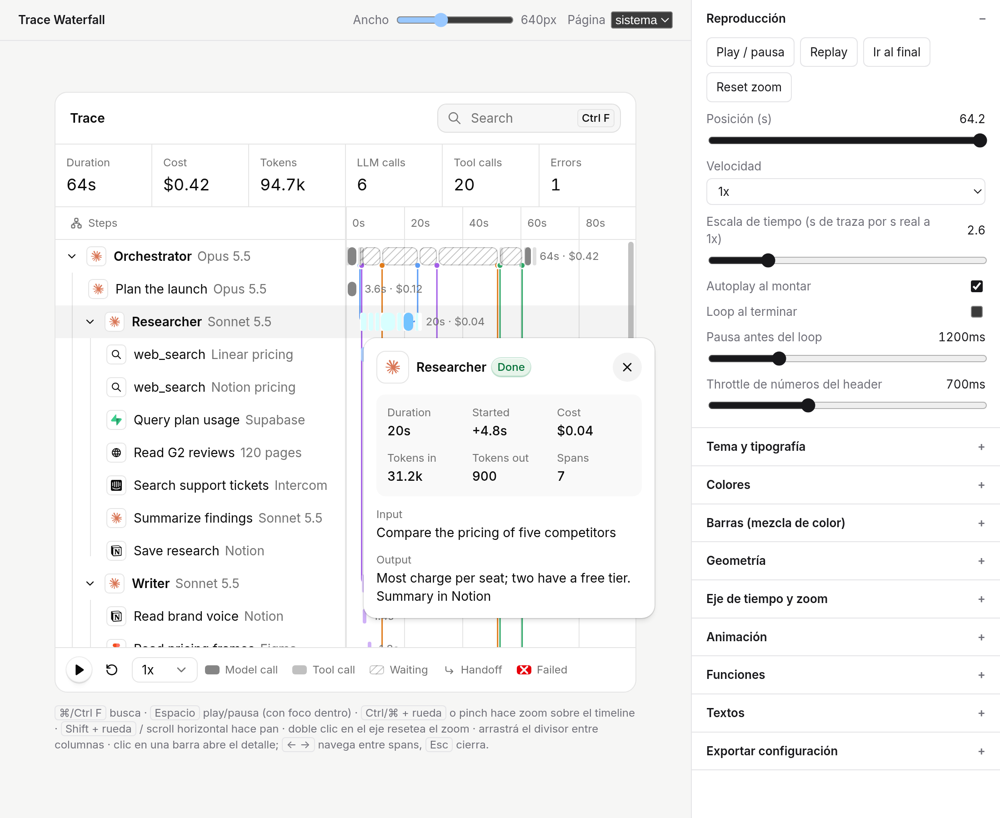

# Trace Waterfall

Una línea de tiempo en vivo para corridas de agentes de IA: cada span (agente, llamada al modelo, herramienta) es una fila de un árbol con su barra sobre un eje de tiempo compartido. Incluye conectores de handoff, búsqueda, zoom/pan, popover de detalle, lanes sticky, métricas animadas y modo claro/oscuro.

- **Sin dependencias.** JS puro + CSS, con wrapper de React y tipos de TypeScript.
- **Datos de verdad.** Acepta tu propio formato (`mapSpan` / `fieldMapper`), OpenTelemetry (`fromOpenTelemetry`), timestamps absolutos o relativos, y streaming en vivo (`upsertSpans`) sin re-renderizar.
- **Todo configurable.** Opciones, hooks de render, eventos y variables CSS `--tw-*` para cada color, medida, duración y easing.

Recreado desde cero a partir del comportamiento de [kobra.systems/components/trace-waterfall](https://kobra.systems/components/trace-waterfall). El desglose de diseño (tokens, medidas, timings, algoritmos) está en [`element.md`](./element.md).

**Demos:** [playground](https://francoescob.github.io/component-replicas/components/trace-waterfall/) · [streaming en vivo](https://francoescob.github.io/component-replicas/components/trace-waterfall/examples/live.html) · [React](https://francoescob.github.io/component-replicas/components/trace-waterfall/examples/react.html)



## Instalación

Elegí la que te sirva:

```bash
# 1. Copiar el componente a tu proyecto (estilo shadcn: el código queda tuyo)
npx degit FrancoEscob/component-replicas/components/trace-waterfall src/components/trace-waterfall

# 2. Como dependencia desde GitHub (pnpm)
pnpm add "github:FrancoEscob/component-replicas#path:/components/trace-waterfall"
```

```html
<!-- 3. Sin build: CDN -->
<link rel="stylesheet" href="https://cdn.jsdelivr.net/gh/FrancoEscob/component-replicas@main/components/trace-waterfall/dist/trace-waterfall.css" />
<script type="module">
  import { TraceWaterfall } from 'https://cdn.jsdelivr.net/gh/FrancoEscob/component-replicas@main/components/trace-waterfall/dist/trace-waterfall.esm.js';
</script>
<!-- o como global: dist/trace-waterfall.global.js → window.TraceWaterfallLib.TraceWaterfall -->
```

## Uso

### JavaScript

```js
import { TraceWaterfall } from './trace-waterfall/src/index.js';
import './trace-waterfall/src/trace-waterfall.css';

const tw = new TraceWaterfall(document.querySelector('#trace'), {
  spans: [
    { id: 'run', kind: 'agent', name: 'Support agent', subtitle: 'Opus 5.5', start: 0, end: 10 },
    { id: 'plan', parentId: 'run', kind: 'model', name: 'Plan', start: 0.3, end: 1.9, tokensIn: 2100, tokensOut: 310, cost: 0.02 },
    { id: 'db', parentId: 'run', kind: 'tool', name: 'Query orders', subtitle: 'Postgres', start: 2.1, end: 3.4 },
  ],
});
```

### React / Next.js

```tsx
import { TraceWaterfall } from '@/components/trace-waterfall/react/TraceWaterfall';

<TraceWaterfall
  spans={spans}                       // cambiar el array parchea las filas en su lugar, sin remontar
  theme="dark"
  clock="live"
  onOpen={(span) => setSelected(span.id)}
  ref={twRef}                         // instancia: twRef.current.seek(10), .upsertSpans(...)
/>
```

El wrapper es `'use client'`. Las opciones se comparan por valor, así que pasar objetos literales en cada render no re-renderiza el gráfico. Se distribuye como `.tsx`: si lo instalás como dependencia (no copiado), en Next.js agregá `transpilePackages: ['@component-replicas/trace-waterfall']`.

## El formato de datos

```ts
interface Span {
  id: string | number;
  parentId?: string | number | null;   // arma el árbol
  kind?: 'agent' | 'model' | 'tool';   // 'agent' = lane: su barra se deriva de sus hijos
  name: string;
  subtitle?: string;                   // modelo o herramienta, en gris
  icon?: string;                       // clave de `icons`, o un <svg> directo
  color?: string;                      // color del lane; los hijos lo heredan
  start: number | string | Date;       // segundos (o `timeUnit`), epoch, ISO o Date
  end?: number | string | Date | null; // null = todavía corriendo
  status?: 'ok' | 'error';
  cost?: number; tokensIn?: number; tokensOut?: number;
  input?: string; output?: string; error?: string;
}
```

- **Tiempos absolutos** (epoch ms/ns, ISO, Date) se re-basan solos para que la traza arranque en 0 (`origin: 'auto'`). Para números en otra unidad usá `timeUnit: 'ms' | 'us' | 'ns'`.
- **Barras de un lane:** se parten automáticamente en llamadas al modelo (color pleno), herramientas (50%), huecos o "pensando" (24%) y espera rayada mientras corre un sub-agente. Un lane sin `color` sale en gris.
- **Validación:** `validate: true` avisa por consola sobre ids duplicados, padres inexistentes, ciclos o `end < start`, y lo corrige sin romper.

### Tus propios datos

```js
import { fieldMapper } from './trace-waterfall/src/index.js';

new TraceWaterfall(el, {
  spans: rowsFromMyApi,
  timeUnit: 'ms',
  mapSpan: fieldMapper({
    id: 'span_id', parentId: 'parent_span_id', start: 'started_at', end: 'ended_at',
    name: 'name', subtitle: 'attributes.model',
    kind: (r) => (r.type === 'llm' ? 'model' : r.type === 'agent' ? 'agent' : 'tool'),
    cost: (r) => r.usage?.cost_usd,
  }),
});
// o cualquier función: mapSpan: (raw, i) => ({ id: raw.uuid, … })
```

### OpenTelemetry

```js
import { fromOpenTelemetry } from './trace-waterfall/src/index.js';

const spans = fromOpenTelemetry(otlpJsonExport); // { resourceSpans: [...] }, array de spans OTLP o ReadableSpan del SDK
new TraceWaterfall(el, { spans });
```

Entiende las convenciones GenAI (`gen_ai.operation.name`, `gen_ai.request.model`, `gen_ai.usage.*`, `gen_ai.agent.name`, `gen_ai.tool.name`) y OpenInference (`openinference.span.kind`, `llm.*`, `input.value`, `output.value`). Podés sobrescribir el tipo, el costo o el ícono con `fromOpenTelemetry(data, { kind, cost, icon })`.

## Relojes

| `clock` | Para qué |
|---|---|
| `'replay'` (default) | Reproducir una traza terminada: play/pausa, velocidad (`speed`, `timeScale`), loop |
| `'live'` | Una corrida en curso: `now` sigue al reloj real desde `startedAt` (o desde el primer span). Se congela cuando todo terminó |
| `'controlled'` | Vos manejás el tiempo con `tw.setNow(t)` (por ejemplo, sincronizado con un video o un slider) |

### Streaming en vivo

```js
const tw = new TraceWaterfall(el, { spans: [], clock: 'live', timeUnit: 'ms' });

socket.on('span.start', (s) => tw.upsertSpans({ ...s, end: null }));
socket.on('span.end',   (s) => tw.upsertSpans({ id: s.id, end: s.end, output: s.output }));  // merge por id
```

`upsertSpans`, `setSpans` y `removeSpans` reconcilian contra el DOM existente: las filas que no cambiaron no se tocan, el scroll y el popover abierto se mantienen, y las filas nuevas entran con su animación.

## API

```ts
tw.play(); tw.pause(); tw.toggle(); tw.replay();
tw.seek(30); tw.setNow(30); tw.setSpeed(2);
tw.setSpans(spans); tw.upsertSpans(spanOrSpans); tw.removeSpans(ids);
tw.getSpan(id);                 // span resuelto (con parent, children, depth, agg)
tw.setQuery('stripe'); tw.setTheme('dark'); tw.resetZoom();
tw.update({ ...cualquierOpcion }); // mantiene tiempo, play, búsqueda, colapsados y ancho de columna
tw.on('complete', (summary) => {}); // devuelve una función para desuscribirse
tw.destroy();
```

**Eventos** (como opción `onX` o con `tw.on('x', fn)`): `open`, `close`, `spanclick` (llamá a `event.preventDefault()` para no abrir el popover), `now`, `playchange`, `toggle`, `search` y `complete`, que recibe `{ duration, cost, tokens, llmCalls, toolCalls, errors }`.

## Personalización

### Opciones

Todas tienen default; ver `DEFAULTS` en [`src/trace-waterfall.js`](./src/trace-waterfall.js) y los tipos en [`src/index.d.ts`](./src/index.d.ts).

| Grupo | Claves |
|---|---|
| General | `title`, `theme`, `icons`, `tokens`, `collapsed` |
| Reloj | `clock`, `startedAt`, `autoplay`, `loop`, `loopDelay`, `speed`, `speeds`, `timeScale`, `startAt` |
| Datos | `timeUnit`, `origin`, `mapSpan`, `validate` |
| Eje | `domain: { min, headroom, maxTicks, steps }`, `zoom: { enabled, wheelFactor, minDomain }` |
| Medidas | `layout: { rowHeight, laneBarHeight, stepBarHeight, laneBarRadius, stepBarRadius, indent, maxHeight, minLabel, labelWidth, popoverWidth, radius }` |
| Barras | `mix: { model, tool, gap, neutral, hatch, hatchGap, glow }` |
| Funciones | `features: { header, search, shortcut, stats, axis, gridlines, nowLine, handoffs, slowest, stickyLanes, popover, collapse, resize, figures, controls, speedSelect, legend, follow, numberMorph, treeGuides, hoverRows, statusIcons, failShake }` |
| Métricas | `stats: ['duration', 'cost', …, { key, label, value: (ctx) => … }]` |
| Textos | `labels` (todos, incluido `emptyText(q)` como función) |
| Formato | `format: { duration, cost, tokens, tick, started, speed }` |
| Animación | `motion: { reduced: 'auto' \| true \| false, statThrottle }` |

### Hooks de render

```js
new TraceWaterfall(el, {
  spans,
  colorFor: (span) => (span.kind === 'agent' ? palette[span.name] : undefined),
  renderIcon: (span) => myIconSvg(span.subtitle),            // Node o string <svg>
  figure: (span, { duration, format }) => `${format.duration(duration)} · ${span.tokensOut ?? 0} tok`,
  renderDetails: (span) => [['Trace id', span.raw.traceId], ['Region', span.raw.region]],
  stats: ['duration', 'cost', { key: 'p95', label: 'p95', value: (c) => `${calcP95(c.spans)}s` }],
});
```

### Estilos

Cada color, medida, radio, duración y easing es una variable CSS. Sobrescribila en tu CSS (`.tw { --tw-card: … }`) o con `tokens: { '--tw-dur-row': '600ms' }`. Las principales:

`--tw-background` `--tw-foreground` `--tw-card` `--tw-popover` `--tw-border` `--tw-muted` `--tw-muted-foreground` `--tw-destructive` `--tw-ring` `--tw-amber-*` `--tw-green-fg` · `--tw-font` `--tw-font-size` · `--tw-radius*` `--tw-row-h` `--tw-max-h` · `--tw-ease` `--tw-ease-quint` `--tw-ease-pop` `--tw-dur-row` `--tw-dur-collapse` `--tw-dur-fade` `--tw-dur-sweep` `--tw-dur-popover` `--tw-dur-morph` …

El layout responde al ancho del **contenedor**, no al viewport (container queries a 28, 32, 36 y 48 rem), así que funciona igual en un sidebar que a pantalla completa. `prefers-reduced-motion` se respeta por defecto.

## Interacción

<kbd>⌘/Ctrl F</kbd> busca (con el puntero o el foco dentro) · <kbd>Espacio</kbd> play/pausa · <kbd>Ctrl/⌘ + rueda</kbd> o pinch hace zoom anclado al cursor · <kbd>Shift + rueda</kbd> hace pan · doble clic en el eje resetea el zoom · se puede arrastrar el divisor de columnas (o usar flechas con foco, <kbd>Esc</kbd> resetea) · clic en una barra abre el detalle, <kbd>← →</kbd> navega entre spans y <kbd>Esc</kbd> cierra.

## Desarrollo

```bash
npm install
npm run dev        # http://localhost:4817 → index.html (playground), examples/
npm run build      # dist/ (ESM, IIFE, CSS) + standalone.html
npm run typecheck
npm run build:react-demo
```

| Archivo | |
|---|---|
| `src/trace-waterfall.js` · `.css` | El componente |
| `src/adapters.js` | `fromOpenTelemetry`, `fieldMapper` |
| `src/index.js` · `index.d.ts` | Entrada y tipos |
| `react/TraceWaterfall.tsx` | Wrapper de React |
| `dist/` | Bundles listos (ESM, global, CSS) |
| `index.html` · `standalone.html` | Playground con panel de configuración (el standalone abre con doble clic) |
| `examples/` | Streaming en vivo, React y ejemplos tipados |
| `demo/` | Traza de demo e íconos |
| `element.md` | Desglose de diseño del original |

## Créditos

El diseño y el comportamiento son de [Kobra](https://kobra.systems), por [Harsh Singh](https://x.com/haaarshsingh). Si te sirve, considerá apoyar el original. El código de esta carpeta es una reimplementación propia (MIT) y no contiene código de Kobra. Los logos de la demo (Anthropic, OpenAI, Stripe, Slack, etc.) son marcas de sus dueños y se usan solo como ejemplo.
